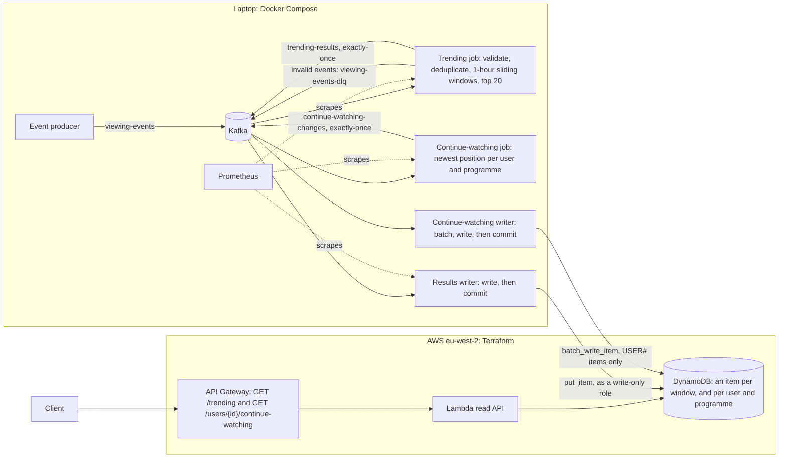
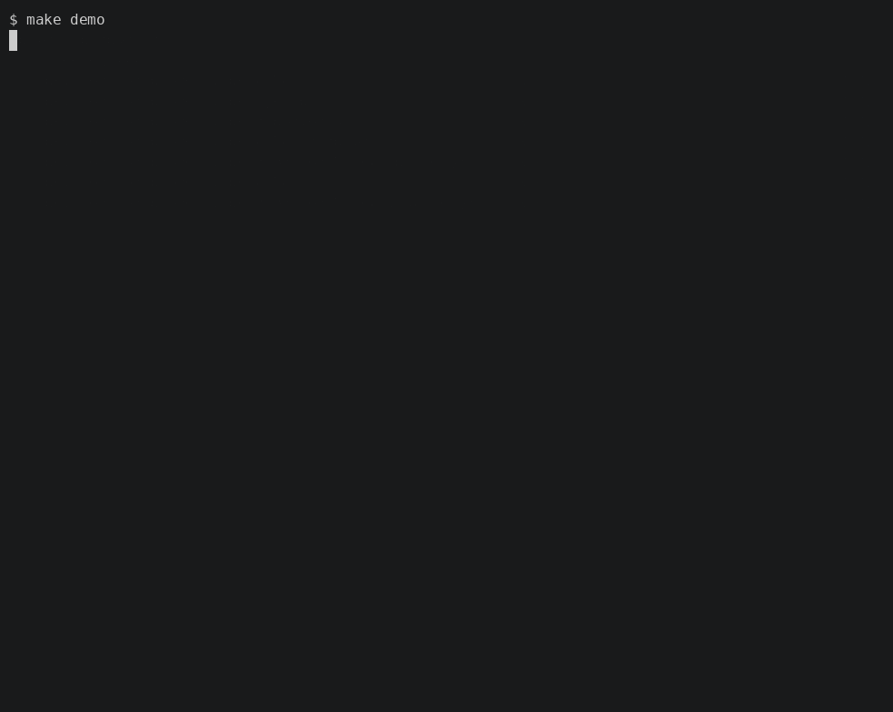

[](https://github.com/Cwazycodes/recommendation-pipeline/actions/workflows/ci.yml)
[](https://codecov.io/gh/Cwazycodes/recommendation-pipeline)
[](LICENSE)

# Real-Time Recommendation Pipeline

A streaming pipeline that ranks trending TV programmes from viewing events. Kafka and Flink count each programme's distinct viewers over the last hour, every five minutes, and a serverless API on AWS serves the latest top 20. A second job keeps each viewer's place in the programmes they haven't finished, for a continue-watching list per user. The hard parts of streaming are the point: event time, duplicate events, exactly-once results and crash recovery, each backed by tests, failure drills and benchmarks.

## How it works



1. The producer sends synthetic viewing events to Kafka, each stamped with the time it happened.
2. The Flink job dead-letters invalid events, drops repeated `event_id`s, counts distinct viewers per programme in 1-hour windows that slide every 5 minutes, and ranks the top 20. Each window's list goes to `trending-results` in a Kafka transaction that commits with a checkpoint, so readers see every row exactly once.
3. The results writer stores each window as one DynamoDB item keyed by its end time, and commits its Kafka offsets only after the write. A crash replays at most a window, and rewriting it changes nothing.
4. A second Flink job keys the same events by viewer and keeps the newest position in each programme; a repeated or late, older event changes nothing. It publishes upserts and deletes to `continue-watching-changes` exactly once, dropping a programme once more than 90% of it is watched, and its writer applies them to DynamoDB in batches, again committing only after the write.
5. API Gateway and a Lambda answer `GET /trending` with the newest list, and `GET /users/{id}/continue-watching` with that viewer's programmes, most recent first.

Kafka and Flink run on a laptop; the table and the API run in AWS, deployed with Terraform from GitHub Actions. [ADR 4](docs/adr/0004-hybrid-local-aws.md) explains why.

## Proof points

| Claim | Evidence |
|---|---|
| Recovers from crashes without losing or repeating results | Four failure drills pass: TaskManager killed, Kafka restarted, writer killed mid-batch, DynamoDB down for 30 s. Output matches a reference implementation, with one item per window ([reliability.md](docs/reliability.md)) |
| Counts are right | The Flink job's output equals a plain-Python oracle on ties, late events, duplicates and empty windows ([design.md](docs/design.md#testing-against-an-oracle)) |
| Known throughput and bottleneck | 150 events/s sustained at parallelism 1 and 201 at parallelism 2 on a 4-core laptop, with processing p95 inside the 30 s target. Deduplication, a Python operator, is the bottleneck ([benchmarks.md](docs/benchmarks.md)) |
| Works against real AWS | The local pipeline writes to DynamoDB in London and the public API serves it: [`GET /trending`](https://9buaaxqrt5.execute-api.eu-west-2.amazonaws.com/trending) returns the list from the last run, throttled to 1 request a second. A put takes 28 ms at the median ([benchmarks.md](docs/benchmarks.md#dynamodb-in-aws)) |
| Continue watching meets the same bar | The second job's output, applied in order, equals a second oracle, also at parallelism 2. A drill kills its TaskManager and then its writer, and the table still matches the oracle. It sustains 500 events/s at parallelism 1 ([design.md](docs/design.md#7-continue-watching), [reliability.md](docs/reliability.md), [benchmarks.md](docs/benchmarks.md#continue-watching)) |
| No stored cloud credentials | GitHub Actions deploys through OIDC with a role only `main` of this repository can assume, and every role is least-privilege ([design.md](docs/design.md#deployment-terraform)) |

## Quick start

You need Docker, Python 3.11 and Poetry.

```bash
make install   # dependencies, and .env from .env.example
make demo      # the whole pipeline in Docker for 2 minutes, then GET /trending
make check     # lint, type check and the unit tests
```

`make demo` starts Kafka, Flink, DynamoDB Local and Prometheus, runs the pipeline with 2-minute windows sliding every 10 seconds so results appear within a minute, and prints the trending list and the run's throughput and latency. The first run builds the Flink image, which takes a few minutes. It needs ports 9092, 8080, 8081, 8001, 9090 and 9464, and most of a 4 GB Docker VM.



*`make demo`, with the waits shortened. The elapsed time at the start of each line is real; `asciinema play docs/demo.cast` plays it at full speed.*

## Testing strategy

| Level | Run with | What it covers |
|---|---|---|
| Unit | `make test`, in CI | 290 tests: validation, deduplication, window rules, the continue-watching rule, both writers' commit and crash behaviour (fake Kafka, moto for DynamoDB), both API routes, settings, and a check that no host, port, topic or table is written into the code |
| Flink against an oracle | `make test-flink`, in CI | Each job's own logic in a local Flink mini-cluster: deduplication and the trending SQL against `trending_oracle.py`, and the continue-watching state against `continue_watching_oracle.py` |
| Integration | `make test-int`, in CI | Kafka and DynamoDB Local in throwaway containers: the producer, the writer killed and restarted, the API and the table |
| End to end | `make test-e2e` | The demo on the local stack: the first window must reach DynamoDB within 90 s |
| Failure drills | `make chaos` | The five drills above, recorded in [reliability.md](docs/reliability.md) |
| Performance | `make bench`, `make cw-bench` | Throughput, lag and latency at increasing rates, and the continue-watching job at one, recorded in [benchmarks.md](docs/benchmarks.md) |
| Infrastructure | `make tf-check`, in CI | `terraform fmt` and `validate` for both Terraform roots, without AWS access |

The coverage badge counts the unit tests only. The command-line tools are exercised by the end-to-end test, the drills and the benchmarks instead.

## Deploy to AWS

The trending table and the read API run in AWS, in eu-west-2, defined in Terraform ([design.md](docs/design.md#deployment-terraform)). You need Terraform 1.17 or later and the AWS CLI, signed in with `aws login --profile rp`.

Once per account, `make bootstrap` creates the Terraform state bucket and the role GitHub Actions deploys with. After that, run **Deploy** from the repository's Actions tab, or deploy from your machine:

```bash
make deploy    # builds the Lambda package, then creates the table, Lambda, HTTP API, logs and IAM roles
curl "$(make -s api-url)"
make destroy   # deletes all of it
```

To run the local pipeline against the deployed table and API ([design.md](docs/design.md#hybrid-run-local-streaming-aws-serving)):

```bash
make up && make topics
make submit-job JOB=validate_events
make submit-job JOB=continue_watching
make writer-aws                           # in a second terminal; Ctrl-C stops it
make cw-writer-aws                        # in a third terminal
make produce RATE=20 DURATION=600 LIVE=1
curl "$(make -s api-url)"                 # about 6 minutes in: the latest list
curl "$(make -s api-url | sed 's#/trending$##')/users/user-00040/continue-watching"
```

## What I'd change for production

- **Managed streaming:** Amazon MSK and Amazon Managed Service for Apache Flink instead of the laptop, with three brokers, replicated topics and checkpoints in S3. The smallest version costs about $280 a month, which is why it isn't running ([design.md](docs/design.md#production-mapping-not-deployed)).
- **Deduplication in Flink SQL:** the Python operator caps throughput at about 190 events/s per subtask; the same rule in SQL runs in the JVM ([ADR 2](docs/adr/0002-dedup-state-ttl.md)).
- **A results path that scales out:** more partitions on `trending-results` and a writer that tracks windows per partition, instead of one partition and one writer ([ADR 3](docs/adr/0003-idempotent-writes.md)).
- **Plausibility checks on `event_time`:** a far-future timestamp would push its partition's watermark ahead and make the events that follow late.
- **Alarms:** CloudWatch alarms on growing consumer lag, dead-lettered events and processing p95 above 30 s, rather than reading Prometheus by hand.
- **Tighter IAM and edge protection:** the deploy role trusts any workflow run on `main`; adding the workflow file (`job_workflow_ref`) to the token's subject would limit it to Deploy. A permissions boundary on the stack's roles would stop a deploy widening them, and AWS WAF rate rules, through CloudFront, would protect the API.
- **Fewer continue-watching writes:** the job publishes a change for nearly every heartbeat. Publishing a programme's position at most once a minute, plus every pause and finish, would cut the writes many times over ([ADR 5](docs/adr/0005-continue-watching-state.md)).
- **Environments:** separate AWS accounts for staging and production, with GitHub environments and a reviewed `terraform plan` before each apply.

## Documentation

- [design.md](docs/design.md): how each part works, and its guarantees
- [docs/adr/](docs/adr/README.md): the five main decisions and their trade-offs
- [metrics.md](docs/metrics.md): what each number means and where it comes from
- [benchmarks.md](docs/benchmarks.md): throughput, latency and the bottleneck, measured
- [reliability.md](docs/reliability.md): the failure drills and their recorded results

<details>
<summary>All make targets (<code>make help</code>)</summary>

```text
 make help             Show all available targets and their descriptions.
  make install          Install project and default development dependencies.
  make fmt              Format Python code with Ruff.
  make lint             Check Python code style with Ruff.
  make typecheck        Run static type checking with mypy.
  make test             Run automated tests and generate terminal and XML coverage reports.
  make test-flink       Run the slow tests that start a local Flink mini-cluster (needs Java).
  make check            Run linting, type checking, and tests.
  make hooks            Install Git pre-commit hooks.
  make generate         Generate synthetic viewing events.
  make up               Start the local Kafka stack.
  make down             Stop the local Kafka stack.
  make down_delete      Stop the local Kafka stack and delete kafka data.
  make topics           Create the Kafka topics named in .env.
  make logs             Follow logs from the Kafka containers.
  make produce          Produce synthetic events to local Kafka (LIVE=1 stamps them with the time they are sent).
  make test-int         Run integration tests (Kafka and DynamoDB Local in Docker).
  make submit-job       Submit a PyFlink job from jobs/ (e.g. make submit-job JOB=validate_events).
  make stop-job         Stop a running job with a savepoint to the checkpoint volume (JOB_NAME=continue-watching picks which).
  make check-trending   Check trending-results for gaps and duplicates, reading only committed rows.
  make db-init          Create the DynamoDB Local table from infra/dynamodb/trending-table.json.
  make db-smoke         Write sample windows to DynamoDB Local and read the latest back.
  make writer           Write trending-results windows to DynamoDB Local (Ctrl-C stops it cleanly).
  make writer-aws       Write trending-results windows to DynamoDB in AWS instead, as the writer's role (AWS_WRITER_PROFILE).
  make check-writer     Check the table holds one correct item per window on trending-results.
  make api-local        Call the API's Lambda handler against DynamoDB Local (GET /trending?limit=LIMIT).
  make cw-writer        Write continue-watching changes to DynamoDB Local (Ctrl-C stops it cleanly).
  make cw-writer-aws    Write continue-watching changes to DynamoDB in AWS instead, as the writer's role (AWS_WRITER_PROFILE).
  make cw-api-local     Call the API's Lambda handler for USER_ID's continue-watching list against DynamoDB Local.
  make demo             Run the whole pipeline on demo topics with 2-minute windows and print the trending list.
  make test-e2e         End-to-end test on the local stack: demo results reach DynamoDB in the agreed time.
  make chaos            Run the failure drills on the local stack and record the results in docs/reliability.md.
  make metrics          Print throughput, consumer lag and latency p50/p95/p99 for the last MINUTES (default 5); TOPIC=viewing-events-demo during a demo.
  make bench            Benchmark live runs at each of RATES events/s for BENCH_DURATION s each (PARALLELISM, PARTITIONS, SEED) into BENCH_DIR.
  make bench-report     Redraw the benchmark charts and print the results table from BENCH_DIR (default docs/benchmarks/).
  make bench-aws        Benchmark one run at AWS_BENCH_RATE events/s with the writer on DynamoDB in AWS (AWS_WRITER_PROFILE), into BENCH_AWS_DIR.
  make cw-bench         Benchmark the continue-watching job at each of CW_RATES events/s for BENCH_DURATION s into CW_BENCH_DIR.
  make package-lambda   Build the API's Lambda package, build/lambda.zip: the handler's modules and the lambda dependency group.
  make tf-check         Check the Terraform is formatted and valid, without AWS access (CI runs this).
  make tf-plan          Show what make deploy would change in AWS (AWS_PROFILE, default rp; run aws login first).
  make deploy           Create or update the AWS stack: table, Lambda, HTTP API, logs and IAM roles (asks first).
  make destroy          Delete everything make deploy created (asks first).
  make api-url          Print the deployed API's URL, e.g. curl "$(make -s api-url)"; it reads the S3 state, so it uses AWS_PROFILE too.
  make bootstrap        Create the state bucket and GitHub's deploy role, once, with your own profile (infra/bootstrap; asks first).
```

</details>

## License

[MIT](LICENSE)
