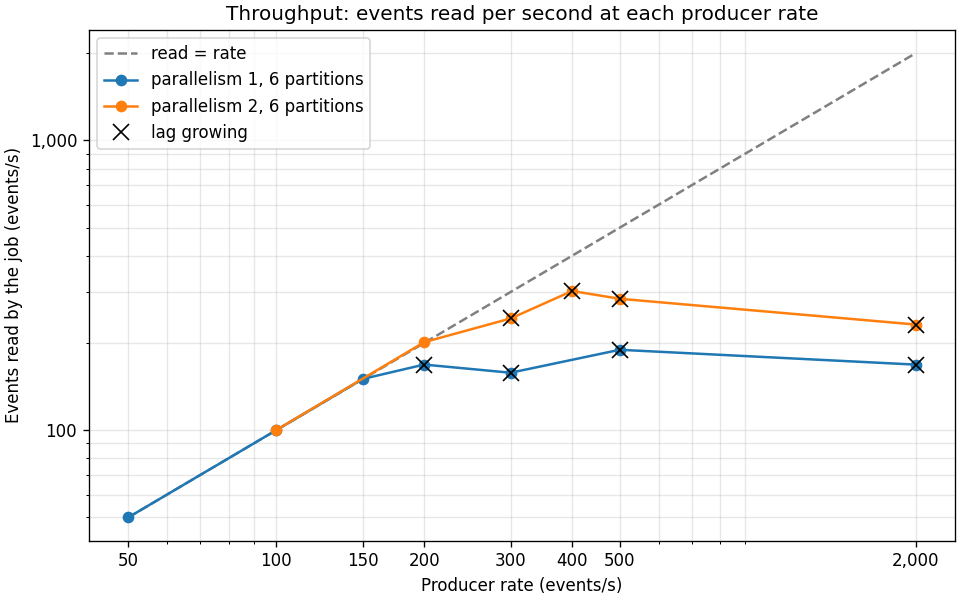
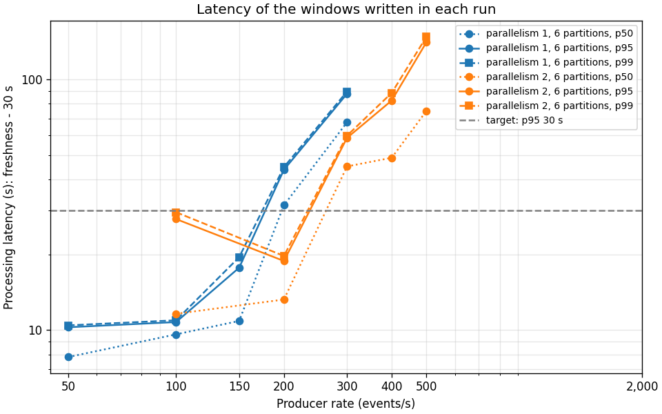
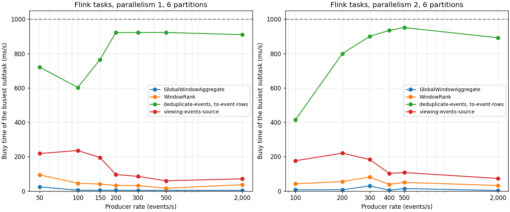

# Benchmarks

How much load the pipeline takes on a laptop, where it breaks, why, and what one change bought. Every number is defined in [metrics.md](metrics.md). `make bench` produced the raw results in [benchmarks/](benchmarks/): `results.csv` (one row per run), `tasks.csv` (each Flink task's busy time per run), `machine.json` and the charts.

## Setup

- **Machine:** Intel Core i5-8257U (4 cores, 8 threads, 1.4 GHz), 8 GB RAM, macOS 15.8.1.
- **Docker:** Docker Desktop 28.0.1, its VM given 8 CPUs and 3.8 GiB.
- **Stack:** the Compose stack from `make up`. One Kafka 3.9.1 broker, Flink 1.20.1 with one TaskManager (2 task slots, 1.7 GiB, of which 0.5 GiB managed memory for RocksDB and the Python workers), DynamoDB Local, Prometheus and kafka-exporter. The producer and the results writer run on the host.
- **Job:** the demo's: 2-minute windows sliding every 10 seconds, top 20 programmes by distinct viewers, exactly-once results with a checkpoint every 10 seconds.
- **Events:** live events from the generator with seed 42 (1,000 viewers, 500 programmes with Zipf popularity), no duplicates or malformed events. The events topic has 6 partitions.

## Method

`make bench RATES="..." PARALLELISM=n` runs each rate once, one after another. Each run:

1. restarts the TaskManager, so every run starts from the same state (memory left over from the last run's RocksDB and Python workers otherwise built up until a later run's Python workers could not start);
2. creates the demo topics empty, submits a new job and starts a new results writer;
3. sends live events at the rate for 120 seconds;
4. waits 30 seconds for the last windows to be committed and written;
5. reads the run's numbers from Prometheus and stops the job with a savepoint.

Throughput, consumer lag and busy time leave out the first 20 seconds of sending, while the new job's Python workers warm up. Latency covers the windows written from then until the end of the wait. A run keeps up if its lag is steady or shrinking. The **breaking point** is the lowest rate whose lag grew, and **sustained throughput** is the highest rate below it that kept up.

The two setups below took about 45 minutes together:

```bash
make bench RATES="50 100 150 200 300 500 2000" PARALLELISM=1
make bench RATES="100 200 300 400 500 2000" PARALLELISM=2
make bench-report   # redraws the charts and prints the table below
```

## Results

| Parallelism | Partitions | Rate (events/s) | Produced/s | Read/s | Lag at end | Lag trend | Windows | Processing p50 / p95 / p99 (s) | Busiest task (busy ms/s) |
|---:|---:|---:|---:|---:|---:|---|---:|---|---|
| 1 | 6 | 50 | 50 | 50 | 0 | steady | 9 | 7.8 / 10.3 / 10.4 | deduplicate-events, to-event-rows (721) |
| 1 | 6 | 100 | 100 | 100 | 0 | steady | 9 | 9.6 / 10.8 / 10.9 | deduplicate-events, to-event-rows (603) |
| 1 | 6 | 150 | 150 | 150 | 0 | steady | 9 | 10.9 / 17.8 / 19.6 | deduplicate-events, to-event-rows (765) |
| 1 | 6 | 200 | 200 | 168 | 4,068 | growing | 9 | 31.5 / 43.6 / 44.7 | deduplicate-events, to-event-rows (922) |
| 1 | 6 | 300 | 300 | 158 | 16,354 | growing | 3 | 67.5 / 87.8 / 89.5 | deduplicate-events, to-event-rows (922) |
| 1 | 6 | 500 | 500 | 189 | 37,406 | growing | 0 | n/a / n/a / n/a | deduplicate-events, to-event-rows (923) |
| 1 | 6 | 2,000 | 2,000 | 168 | 218,180 | growing | 0 | n/a / n/a / n/a | deduplicate-events, to-event-rows (910) |
| 2 | 6 | 100 | 100 | 100 | 0 | steady | 9 | 11.6 / 27.8 / 29.6 | deduplicate-events, to-event-rows (415) |
| 2 | 6 | 200 | 202 | 201 | 649 | steady | 9 | 13.2 / 18.9 / 19.8 | deduplicate-events, to-event-rows (800) |
| 2 | 6 | 300 | 300 | 243 | 6,212 | growing | 6 | 45.0 / 58.5 / 59.7 | deduplicate-events, to-event-rows (901) |
| 2 | 6 | 400 | 400 | 302 | 11,265 | growing | 5 | 48.8 / 82.5 / 88.5 | deduplicate-events, to-event-rows (935) |
| 2 | 6 | 500 | 500 | 284 | 22,608 | growing | 3 | 75.0 / 141.0 / 148.2 | deduplicate-events, to-event-rows (951) |
| 2 | 6 | 2,000 | 1,999 | 232 | 209,039 | growing | 0 | n/a / n/a / n/a | deduplicate-events, to-event-rows (892) |

- Parallelism 1, 6 partitions: sustained 150 events/s; lag grew from 200 events/s.
- Parallelism 2, 6 partitions: sustained 201 events/s (the 200 events/s run); lag grew from 300 events/s.







## Analysis

### Breaking point

With the job at parallelism 1, the pipeline keeps up to 150 events/s and falls behind at 200. Beyond that, the job reads 158 to 189 events/s however fast events arrive, so the rest pile up: 218,180 records behind after two minutes at 2,000 events/s. Latency follows. Processing p95 is under 20 seconds up to 150 events/s, 44 seconds at 200, and close to 90 seconds at 300.


Those 90 seconds understate how bad it gets. When the job falls behind, the watermark falls behind with it (53 s at 200 events/s, and 138 s at 2,000, instead of 30 s), so fewer windows fire during the run (3 at 300 events/s, none at 500 or 2,000), and the latency columns only count the windows that did fire.


### Bottleneck: deduplication

The busy-time chart shows the bottleneck. One task, `deduplicate-events` chained with `to-event-rows`, is the busiest in every run, and once the job falls behind it is busy 890 to 950 ms of every second. Below the breaking point its busy time is noisy (721, 603 and 765 ms/s at 50, 100 and 150 events/s with parallelism 1), but it is always well ahead of the other tasks. Once it saturates, the source task, which reads Kafka and validates events, becomes back-pressured: at parallelism 1, 750 to 846 ms/s spent waiting for the deduplication task to take more. No other task is ever busy more than 236 ms/s, and the window aggregation and ranking stay under 100.


Deduplication is a Python `KeyedProcessFunction`. Every event is sent from the JVM to a Python worker, and its `seen` flag is read and written through Flink's state API. Every `event_id` is new, so that read cannot be answered from the Python worker's state cache and goes back to RocksDB in the JVM. Validation is Python too, but it touches no state, and its task stays under 240 ms/s. In the overloaded runs, the source's record count climbs in steps of about 1,000 every 5 seconds. That suggests the job hands events to the Python worker in batches and waits for each batch to come back.

### One change: parallelism 1 to 2

The job's new `--parallelism` argument (`make bench PARALLELISM=2`) runs the source, validation and deduplication as two subtasks each. The window aggregation, ranking and trending sink stay at one, because the results writer needs each window's rows from a single sink ([design.md](design.md), "Parallelism"). The topic stays at 6 partitions, which the two source subtasks split 3 and 3. Partitions were the wrong thing to change. At parallelism 1, a single source subtask reads all 6 into a single deduplication subtask, so more partitions would only add more for the same subtask to read.

| | Parallelism 1 | Parallelism 2 |
|---|---:|---:|
| Sustained throughput | 150 events/s | 201 events/s |
| Breaking point | 200 events/s | 300 events/s |
| Read when overloaded | 158 to 189 events/s | 232 to 302 events/s |
| Processing p95 at 200 events/s | 43.6 s | 18.9 s |

Sustained throughput rose by a third, from 150 to 201 events/s, and what the job reads when overloaded by about half: 171 events/s on average at parallelism 1, 265 at parallelism 2. The p95 target of 30 seconds (design.md section 6) now holds up to 200 events/s instead of 150. It did not double because deduplication is still the bottleneck. At 300 events/s each of its two subtasks is busy 901 ms/s, and the source is already back-pressured 479 ms/s. Each subtask handles about 120 events/s there, fewer than the single subtask did at 150 events/s, yet it is busier (901 against 765 ms/s), so the two get in each other's way. They share the laptop's 4 cores with each other, the validation workers, Kafka, the JobManager and the producer. With 2 task slots, parallelism 2 is as far as this TaskManager goes.

### What would come next

- Move deduplication out of Python: Flink SQL's deduplication (`ROW_NUMBER() OVER (PARTITION BY event_id ...) = 1`) runs entirely in the JVM.
- Try PyFlink's bundle and state cache settings (`python.fn-execution.bundle.size`, `python.state.cache-size`), given the steps of 1,000 records.
- Add a second TaskManager to go past parallelism 2.

## Caveats

- **One run per rate.** Run-to-run differences are 10 to 20%. An earlier run of this benchmark on the same laptop kept up at 300 events/s with parallelism 2 (294 events/s read), where this one fell behind (243), so the breaking point at parallelism 2 is somewhere between 200 and 300 events/s. The overloaded runs at parallelism 2 read anywhere between 232 and 302 events/s, so smaller differences mean nothing.
- **Few latency samples.** A two-minute run writes about 9 windows, so p95 and p99 are close to the slowest window, and one slow window moves them: at parallelism 2, p95 is 27.8 s at 100 events/s but 18.9 s at 200. The histograms resolve 0.5 s.
- **The laptop.** The 8 GB host was swapping throughout, and the producer, Kafka and Flink share 4 cores. Faster hardware would raise every number. What these runs show is the shape: where the job breaks, and what moved the breaking point.
- **The 10,000 and 25,000 events/s rates.** They were not run: the job tops out near 300 events/s, so they would only show the same plateau. The producer can send 25,000 events/s (checked for 10 seconds), but it builds all its events in memory first, about 0.9 KB each. Two minutes at 25,000 events/s means 3 million events and about 2.7 GB, too much next to a 4 GB Docker VM on an 8 GB laptop. `make bench RATES="10000 25000" BENCH_DURATION=30` keeps it under 1 GB.
